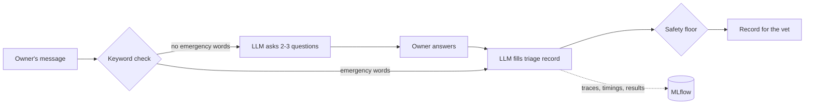

# Pet Triage Demo

A pet owner describes a problem in their own words. The assistant asks 2–3 follow-up questions, then writes a short record for the vet: a complaint code, an urgency level (EMERGENCY, URGENT_24H or ROUTINE), and whether a photo would help. It never diagnoses or suggests treatment.

Built with LangChain and a local model via Ollama (or your own model or API key; see below). Every conversation is tracked in MLflow, which I used to compare prompt versions on a small set of test cases.

**Prototype only.** The test cases are mostly synthetic and labelled by a non-vet. This shows the approach, not clinical safety.



## Quick start

Needs Python 3.11+, plus one way to run a model (see [Choosing a model](#choosing-a-model); the default is [Ollama](https://ollama.com)).

```bash
python -m venv .venv
source .venv/bin/activate          # Windows: .venv\Scripts\activate
pip install -r requirements.txt
pre-commit install                 # secret scan + lint on commit, tests on push
ollama pull qwen2.5:7b             # skip if you use your own model or API
```

| | |
|---|---|
| Web demo | `streamlit run ui.py` |
| Terminal chat | `python cli.py` |
| Run the test cases, logged to MLflow | `python evaluate.py` (add `--prompt-version v1` to compare, or `--baseline lexical` for rules only) |
| Tests (no model needed) | `pytest` (add `-m live` to test against the real model) |
| Lint | `ruff check . && ruff format --check .` |
| MLflow UI | `mlflow ui --backend-store-uri sqlite:///mlflow.db` |

Other settings (prompt version, temperature, timeout) are optional; see `.env.example`.

The web demo and terminal chat are thin front ends over the same conversation code (`triage/core.py`) that the tests and evaluation use. The tests cover the parts that matter most without needing a model: the safety floor, the output schema, the conversation flow, scoring and retries. Coverage isn't a target.

**With Docker** (app and Ollama together): `docker compose up -d`, then `docker compose exec ollama ollama pull qwen2.5:7b`, and open http://localhost:8501.

**Before code leaves your machine**, `pre-commit` runs [gitleaks](https://github.com/gitleaks/gitleaks) (secret scan) and ruff on every commit, and the unit tests on every push. Run them all by hand with `pre-commit run --all-files --hook-stage pre-push`. GitHub Actions then runs the linter, the tests on Python 3.11 and 3.13, and a Docker build on every push.

## Choosing a model

The app talks to the model through LangChain, so the rest of the code doesn't care which one you use. Copy `.env.example` to `.env` (`cp .env.example .env`, or `copy` on Windows) and pick one:

**1. Ollama, local (default).** No `.env` needed for the default. For another model, use any name from `ollama list`:
```bash
TRIAGE_MODEL=qwen2.5:7b            # ~5 GB; qwen2.5:3b is faster but less accurate
# OLLAMA_BASE_URL=http://other-machine:11434
```

**2. Your own local server with an OpenAI-compatible API** (LM Studio, vLLM, llama.cpp server):
```bash
TRIAGE_PROVIDER=openai
TRIAGE_MODEL=<model name as the server lists it>
OPENAI_BASE_URL=http://localhost:1234/v1
OPENAI_API_KEY=not-needed
```

**3. Anthropic API:**
```bash
TRIAGE_PROVIDER=anthropic
TRIAGE_MODEL=claude-sonnet-5-5
ANTHROPIC_API_KEY=<your key>
```

**4. OpenAI API:**
```bash
TRIAGE_PROVIDER=openai
TRIAGE_MODEL=<model name>
OPENAI_API_KEY=<your key>
```

Notes:
- **Keys stay local.** `.env` is git-ignored, and if a key is ever staged anyway, the gitleaks hook blocks the commit. Keys are read by each provider's SDK and never logged to MLflow.
- **Every run records what ran.** Provider, model name and, for Ollama, the exact weights digest are logged as MLflow params, so runs on different models compare side by side.
- **Results depend on the model.** The numbers in [Results](#results) are for one model; rerun `python evaluate.py` on yours.
- **API cost.** A conversation is 2 calls, plus up to 4 more when a red flag is about to be dismissed. A full `evaluate.py` run is a few dozen calls.
- **Docker** runs the Ollama option only; for an API, run the app locally.

## How it works

1. **Keyword check.** The owner's words are scanned for emergency phrases ("nothing comes up", "struggling to breathe"). It's free and predictable, but it can't read context like "*not* struggling to breathe".
2. **Questions.** If there's no emergency phrase, the LLM asks 2–3 follow-up questions. If there is one, it skips straight to the assessment.
3. **Assessment.** The LLM fills a fixed form: summary, complaint code, photo flag, urgency. Codes can only come from our list, enforced while the model writes. For each emergency phrase found, the model also says whether the sign is present, absent or unclear, quoting the owner. That gives the keyword check its context, in the same call.
4. **Safety floor.** Any emergency phrase forces EMERGENCY, unless the model says the sign is absent, its quote really appears in the owner's words, *and* it gives the same answer when asked 4 more times. The rule can only raise urgency, never lower it.
5. **Tracking.** Each conversation is one MLflow run: settings as parameters; latency, retries and checks as metrics; the record as a JSON file. LangChain autologging captures every prompt and response as a trace.

## Results

Model `qwen3.8:27b`, run locally at temperature 0. Six synthetic cases, each worded two ways (12 runs). Counts, not percentages, because the set is small.

| | Rules only (no LLM) | Prompt v1 | Prompt v2 |
|---|---|---|---|
| Emergencies caught | **3 / 4** | 4 / 4 | 4 / 4 |
| Rated less urgent than expected | **5 / 12** | **2 / 12** | 0 / 12 |
| Rated more urgent than expected | 1 / 12 | 0 / 12 | 0 / 12 |
| Complaint code correct | 7 / 12 | 12 / 12 | 12 / 12 |
| Photo flag correct | 11 / 12 | 11 / 12 | 12 / 12 |

**Rules only** is the baseline: the emergency phrase list alone sets urgency (EMERGENCY or ROUTINE), and the complaint synonym lists pick the code. It missed a blocked cat described as "only a few drops of wee come out", which no emergency phrase covers, and it can't tell a hot spot or cut paw needs seeing within 24 hours. It also flagged "not struggling to breathe" as an emergency. Its codes held up on the first wordings (5 / 6) but not on the rewordings (2 / 6), because those first wordings share phrases with the synonym lists. Most of what the LLM adds is coping with paraphrase and grading the middle tier.

v1 rated a spreading, itchy skin sore as ROUTINE, and asked for a photo of a bloated belly. v2 added plain definitions of each urgency level and "when torn, choose the more urgent level". **v2 was written after seeing these failures, so its perfect score is partly fitted to the test.**

**One real case.** My cat developed a painful lump two weeks after being neutered. I wrote the message as I'd have described it on the phone, before running anything, and labelled it with what the vet nurse decided at the time: an appointment the next day. Both wordings matched (URGENT_24H, photo requested), and no prompt was tuned on it. It also exposed a gap: the complaint list had no "lump or swelling" code, so I added one.

## Limits and next steps

- **Not clinically validated.** It needs cases labelled by vets, then a period running silently alongside vets, before anyone relies on it.
- **Placeholder codes.** Real VeNom codes are licensed on request, so this uses made-up `DEMO-xxx` codes. Swapping them in is a data change.
- **Uncertainty.** Agreement between repeat answers shows how sure the model is, not whether it's right. With labelled data it could be calibrated (for example with conformal prediction) into a checked limit on missed emergencies.
- **Monitoring.** In production: watch for shifts in what owners write and what the system outputs, how often vets correct it, and results per species and language. Rerun `evaluate.py` before every prompt or model change.

## Project layout

```
triage/             core logic: schemas, keyword floor, chains, conversation, tracking
prompts/v1, v2      prompt versions compared in MLflow
data/               complaint codes, emergency phrases, test cases
ui.py, cli.py       web and terminal front ends
evaluate.py         runs the test cases
tests/              unit and smoke tests
```

## Glossary

- **Triage:** deciding how urgently a case needs attention. **Under-triage** (rating it less urgent than it is) is the dangerous mistake.
- **VeNom:** a standard UK list of veterinary terms and codes.
- **Structured output:** making the LLM reply in a fixed format with allowed values, instead of free text.
- **Temperature:** how much randomness the model uses when choosing words. At 0 it always picks the most likely word.
- **MLflow run / trace:** a run is one tracked experiment with its settings and results; a trace records each LLM call.

## License

[MIT](LICENSE)
