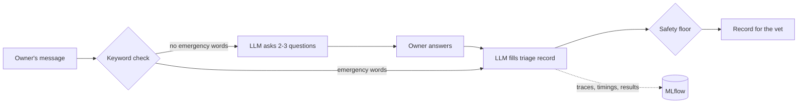

# Pet Triage Demo

A pet owner describes a problem in their own words. The assistant asks 2–3 follow-up questions, then writes a short record for the vet: a complaint code, an urgency level (EMERGENCY, URGENT_24H or ROUTINE), and whether a photo would help. It never diagnoses or suggests treatment.

Built with LangChain, a local model through Ollama (or your own model or API key), and MLflow, which tracks every conversation and was used to compare prompt versions.

**Prototype only.** The test cases are mostly synthetic and labelled by a non-vet. This shows the approach, not clinical safety.



## How it works

1. **Keyword check.** The owner's words are scanned for emergency phrases ("nothing comes up", "struggling to breathe"). It's free and predictable, but it can't read context like "*not* struggling to breathe".
2. **Questions.** With no emergency phrase, the LLM asks 2–3 follow-up questions. With one, it skips straight to the assessment.
3. **Assessment.** The LLM fills a fixed form: summary, complaint code, photo flag, urgency. Codes can only come from our list, enforced while the model writes. For each emergency phrase found, the model also says whether the sign is present, absent or unclear, quoting the owner. That gives the keyword check its context, in the same call.
4. **Safety floor.** Any emergency phrase forces EMERGENCY, unless the model says the sign is absent, its quote really appears in the owner's words, *and* it gives the same answer when asked 4 more times. The rule can only raise urgency, never lower it.
5. **Tracking.** Each conversation is one MLflow run: settings as parameters; latency, retries and safety checks as metrics; the record as a JSON file. LangChain autologging captures every prompt and response as a trace.

## Where the code lives

| File | What it does |
|---|---|
| `triage/conversation.py` | The two-turn conversation. **Start here.** |
| `triage/safety_floor.py` | The keyword check and the rule that can only raise urgency |
| `triage/flag_recheck.py` | Re-asks the model before an emergency flag is dismissed |
| `triage/schemas.py` | The forms the model must fill in, and the final record |
| `triage/chains.py` | LangChain prompts and chains, with one retry on bad output |
| `triage/mlflow_tracking.py` | What gets logged to MLflow |
| `evaluate.py` + `triage/scoring.py` | Runs the test cases and scores them |
| `web_demo.py`, `terminal_chat.py` | Thin front ends over the same conversation code |
| `prompts/v1`, `prompts/v2` | Prompt wording, kept out of the code so versions can be compared |
| `data/` | Complaint codes, emergency phrases and test cases |

`triage/__init__.py` lists the smaller supporting modules. Planned improvements are marked `TODO` in the code, next to where they'd go.

## Results

Model `qwen3.8:27b`, run locally at temperature 0. Six synthetic cases, each worded two ways (12 runs). Counts, not percentages, because the set is small.

| | Rules only (no LLM) | Prompt v1 | Prompt v2 |
|---|---|---|---|
| Emergencies caught | **3 / 4** | 4 / 4 | 4 / 4 |
| Rated less urgent than expected | **5 / 12** | **2 / 12** | 0 / 12 |
| Rated more urgent than expected | 1 / 12 | 0 / 12 | 0 / 12 |
| Complaint code correct | 7 / 12 | 12 / 12 | 12 / 12 |
| Photo flag correct | 11 / 12 | 11 / 12 | 12 / 12 |

- **Rules only** uses just the phrase lists. It missed a blocked cat described as "only a few drops of wee come out", couldn't grade the middle tier, and flagged "*not* struggling to breathe" as an emergency. Most of what the LLM adds is coping with paraphrase and grading the middle tier.
- **v1 → v2.** v1 rated a spreading skin sore as ROUTINE and asked for a photo of a bloated belly. v2 added plain definitions of each urgency level and "when torn, choose the more urgent level". **v2 was written after seeing these failures, so its perfect score is partly fitted to the test.**
- **One real case.** My cat developed a painful lump after being neutered. I wrote the message before running anything and labelled it with what the vet nurse decided at the time (an appointment the next day). Both wordings matched, and no prompt was tuned on it. It also exposed a gap in the complaint list, so I added a "lump or swelling" code.

## Running it

Needs Python 3.11+ and one way to run a model.

```bash
python -m venv .venv
source .venv/bin/activate          # Windows: .venv\Scripts\activate
pip install -r requirements.txt
pre-commit install                 # secret scan and lint on commit, tests on push
ollama pull qwen2.5:7b             # skip if you use your own model or API
```

| | |
|---|---|
| Web demo | `streamlit run web_demo.py` |
| Terminal chat | `python terminal_chat.py` |
| Test cases, logged to MLflow | `python evaluate.py` (`--prompt-version v1` to compare, `--baseline lexical` for rules only) |
| Unit tests (no model needed) | `pytest` (`-m live` to also test against the real model) |
| MLflow UI | `mlflow ui --backend-store-uri sqlite:///mlflow.db` |

**Choosing a model.** Copy `.env.example` to `.env` and set:

| To use | Set |
|---|---|
| Ollama (default) | nothing, or `TRIAGE_MODEL=<name from ollama list>` |
| A local OpenAI-compatible server (LM Studio, vLLM) | `TRIAGE_PROVIDER=openai`, `TRIAGE_MODEL`, `OPENAI_BASE_URL`, `OPENAI_API_KEY=not-needed` |
| Anthropic | `TRIAGE_PROVIDER=anthropic`, `TRIAGE_MODEL`, `ANTHROPIC_API_KEY` |
| OpenAI | `TRIAGE_PROVIDER=openai`, `TRIAGE_MODEL`, `OPENAI_API_KEY` |

Keys stay in the git-ignored `.env` and are never logged. Results depend on the model, so rerun `python evaluate.py` on yours. With Docker (Ollama only): `docker compose up -d`, then `docker compose exec ollama ollama pull qwen2.5:7b`, and open http://localhost:8501. GitHub Actions runs the linter, the tests on Python 3.11 and 3.13, and a Docker build on every push.

## Limits and next steps

- **Not clinically validated.** It needs cases labelled by vets, then a period running silently alongside vets, before anyone relies on it.
- **Placeholder codes.** Real VeNom codes are licensed on request, so this uses made-up `DEMO-xxx` codes. Swapping them in is a data change.
- **Uncertainty.** Agreement between repeat answers shows how sure the model is, not whether it's right. With labelled data it could be calibrated (for example with conformal prediction) into a checked limit on missed emergencies.
- **Monitoring.** In production: watch for shifts in what owners write and what the system outputs, how often vets correct it, and results per species and language. Rerun `evaluate.py` before every prompt or model change.

## Glossary

- **Triage:** deciding how urgently a case needs attention. **Under-triage** (rating it less urgent than it is) is the dangerous mistake.
- **Red flag:** a sign that may mean an emergency, such as unproductive retching. **Lifting** a flag means dismissing it.
- **VeNom:** a standard UK list of veterinary terms and codes.
- **Structured output:** making the LLM reply in a fixed format with allowed values, instead of free text.
- **Temperature:** how much randomness the model uses when choosing words. At 0 it always picks the most likely word.
- **MLflow run / trace:** a run is one tracked experiment with its settings and results; a trace records each LLM call.

## License

[MIT](LICENSE)
