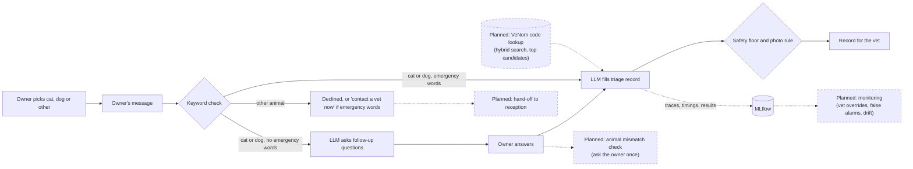

# Pet Triage Demo

A pet owner picks cat, dog or another animal, then describes a problem in their own words. The assistant asks a few follow-up questions (or skips them if it sounds like an emergency), then writes a short record for the vet: a complaint code, an urgency level (EMERGENCY, URGENT_24H or ROUTINE), and whether a photo would help. It's told never to diagnose or suggest treatment. None of the questions owners saw in the test runs did; the notes written for the vet often name a possible condition (see Results).

Built with LangChain, a local model through Ollama (or your own model or API key), and MLflow, which tracks every conversation and was used to compare prompt versions.

**The design rule: the LLM proposes, code decides.** The LLM does what only it can do: read messy owner text, ask questions and propose a code and an urgency. Plain code makes the final call on everything that ends a conversation or sets urgency: which animals are covered, when to skip the questions, the final urgency (the model's choice, raised by the keyword floor when needed, never lowered) and the photo request. Those calls are predictable and traceable.

**Prototype only.** The test cases are mostly synthetic and labelled by a non-vet. This shows the approach, not clinical safety.

The service covers **cats and dogs only**, as an example scope. The owner picks the animal, so scope never depends on the model: another animal is politely declined without calling it, unless an emergency phrase is found, which gets "contact a vet now". A cat or dog is never turned away.



Dashed boxes are planned, not built. Today the 16 placeholder codes are listed in the prompt; with the real VeNom list, a lookup would narrow it to a few candidates that become the allowed values in the record.

## How it works

1. **The owner picks the animal.** Cat, dog or another animal. Another animal is declined by code, with no model call; the keyword check still runs, so "my rabbit is struggling to breathe" gets "contact a vet now". For a cat or dog, the model is told the animal and not to ask which it is (in the test runs it never did).
2. **Keyword check.** The owner's words are scanned for emergency phrases ("nothing comes up", "struggling to breathe"). It's free and predictable, but it can't read context like "*not* struggling to breathe".
3. **Questions.** With no emergency phrase, the LLM asks follow-up questions. It's told to ask two or three; in the test runs it asked one or two. With an emergency phrase, it skips straight to the assessment; if that assessment dismisses the flag with evidence (step 5), the questions follow as usual.
4. **Assessment.** The LLM fills a fixed form: summary, complaint code, urgency and a one-line reason. Codes can only come from our list: with Ollama this is enforced while the model writes, and every reply is checked again afterwards. The model is told to use "Other / not listed" rather than force the nearest wrong code, though it doesn't always (see Results). For each emergency phrase found, the model is also asked whether the sign is present, absent or unclear, quoting the owner. That gives the keyword check its context, in the same call.
5. **Safety floor.** Any emergency phrase forces EMERGENCY, unless the model says the sign is absent, its quote really comes from the owner's words (most of its words appear there, and any "not" sits next to the same word the owner put it next to), *and* it gives the same answer when asked 4 more times. A flag the model doesn't answer about is kept. The rule can only raise urgency, never lower it.
6. **Photo request.** From prompt v4, code decides: a photo is requested for skin (including lumps and itching), wound and eye complaints, never in an emergency. Earlier versions let the model decide. Applied to their records, the rule matched the expected answer more often than the model did (13, 13 and 14 of 14 for v1, v2 and v3, against 12 each).
7. **Tracking.** Each conversation is one MLflow run: settings as parameters; latency, retries and safety checks as metrics; the record as a JSON file. LangChain autologging captures every prompt and response as a trace.

## Where the code lives

| File | What it does |
|---|---|
| `triage/conversation.py` | The two-turn conversation. **Start here.** |
| `triage/safety_floor.py` | The keyword check and the rule that can only raise urgency |
| `triage/flag_recheck.py` | Re-asks the model before an emergency flag is dismissed |
| `triage/schemas.py` | The forms the model must fill in, the final record, and the photo rule |
| `triage/chains.py` | LangChain prompts and chains, with one retry on bad output, and which fields each prompt version uses |
| `triage/mlflow_tracking.py` | What gets logged to MLflow |
| `evaluate.py` + `triage/scoring.py` | Runs the test cases and scores them |
| `web_demo.py`, `terminal_chat.py` | Thin front ends over the same conversation code |
| `prompts/v1` … `v4` | Prompt wording, kept out of the code so versions can be compared (v4 is the default) |
| `data/` | Complaint codes, emergency phrases, test cases and edge cases |

`triage/__init__.py` lists the smaller supporting modules. Planned improvements are marked `TODO` in the code, next to where they'd go.

## Results

Model `qwen2.5:7b` (Ollama weights `845dbda0ea48`, 7.6B, Q4_K_M), run locally at temperature 0 on an RTX 3090, with a median of about 1.5 s per conversation. Six synthetic cases and one real case, each worded two ways (14 runs): exactly what `python evaluate.py` runs. Counts, not percentages, because the set is small: a difference of one or two runs is noise. In MLflow these are the parent runs tagged `study = "readme-results"`. v4 ran a day after the others, with the same model, settings and case wordings; by then each case also recorded the owner's choice of animal.

| | Rules only (no LLM) | Prompt v1 | Prompt v2 | Prompt v3 | Prompt v4 (default) |
|---|---|---|---|---|---|
| Emergencies caught | 3 / 4 | 3 / 4 | 3 / 4 | 3 / 4 | 3 / 4 |
| … by the model alone, before the safety floor | n/a | 1 / 4 | 2 / 4 | 3 / 4 | 2 / 4 |
| Rated less urgent than expected | **7 / 14** | 1 / 14 | 1 / 14 | 1 / 14 | 1 / 14 |
| Rated more urgent than expected | 1 / 14 | 1 / 14 | 1 / 14 | 2 / 14 | 1 / 14 |
| Complaint code correct | 9 / 14 | 12 / 14 | 12 / 14 | 13 / 14 | 12 / 14 |
| Photo flag correct | 13 / 14 | 12 / 14 | 12 / 14 | 12 / 14 | 13 / 14 |
| Cat and dog cases wrongly declined as out of scope | 0 / 14 (can't decline) | 0 / 14 (can't decline) | 0 / 14 (can't decline) | 0 / 14 | 0 / 14 (never declines a cat or dog) |
| Out-of-scope requests declined (edge cases) | 0 / 3 | 0 / 3 | 0 / 3 | 3 / 3 | 2 / 3 |
| Edge cases ending as expected (`--edge-cases`) | 5 / 8 | 5 / 8 | 5 / 8 | 7 / 8 | 7 / 8 |
| Input tokens per conversation (mean) | none | 798 | 929 | 1,131 | 904 |

- **Rules only** uses just the phrase lists. It couldn't grade the middle tier (half its runs were rated less urgent than expected) and flagged "*not* struggling to breathe" as an emergency. Most of what the LLM adds is coping with paraphrase and grading the middle tier.
- **The missed emergency is the same case in every version:** a blocked cat described as "only a few drops of wee come out". No emergency phrase covers that wording, so it depends on the model alone, and no version caught it. The model's own reason sometimes names the risk (v1: a possible blockage that "can be life-threatening") and it still picks URGENT_24H. It's a gap in the phrase list, not in any one prompt.
- **The safety floor earns its place.** With v1 the model alone rated only 1 of the 4 emergency runs as EMERGENCY; the keyword floor raised two more. Across v1–v4, the model left the red-flag checklist empty in 12 of the 19 conversations where it was asked about a flag. When it did fill it in, 4 times out of 7 it quoted our flag label (such as "Breathing difficulty") instead of the owner. An unanswered flag is kept, and a quote that isn't the owner's can't dismiss one.
- **The over-triage is mostly deliberate.** "He's *not* struggling to breathe" ends as EMERGENCY in every version. In v1–v3 the model left the flag check empty; in v4 it answered "absent" but quoted our label instead of the owner, so the quote check rejected it. Either way the floor keeps the flag: it prefers a false alarm to a missed emergency. v3's second over-triage is a morning-bile case rated URGENT_24H.
- **v1 → v2.** v2 added plain definitions of each urgency level and "when torn, choose the more urgent level", after v1 under-triaged a spreading skin sore (both wordings) in an earlier run on a larger model (`qwen3.8:27b`). v2 was written after seeing that failure, so its score is partly fitted to the test. On these runs v1 and v2 tie on every accuracy row; the difference shows only in what the model catches before the floor.
- **v2 → v3.** v3 had the model decide scope (which animal, and whether it's a health problem) and told it to use "Other / not listed" when nothing fits. Without that, every earlier version triages whatever it's given: v2 still codes the raccoon as "Lump or swelling", exactly as in the original exploratory test. v3 declines the raccoon, a hamster and a lead-training question, and still escalates a rabbit that can't breathe. But its judgment wobbles: in this run it declined a dog that suddenly started eating stones as "not a health problem", and in a later check run it triaged the same message.
- **v3 → v4: the owner decides scope, code decides the photo.** The owner picks the animal, so another animal is declined with no model call (the raccoon, hamster and rabbit took at most 0.1 s each) and a cat or dog is never declined. The model no longer writes the species, health-concern or photo fields, so the prompt is shorter: about 20% fewer input tokens, and a median of 1.46 s per conversation against 1.71 s. The photo rule got 13/14 against the model's 12/14: it fixed both bloat runs, where v3 had asked for a photo during an emergency. Its one miss is a cut paw the model coded as lameness, so the rule inherits the model's code errors. The rest of the gap is noise: with less text in the prompt, the model took a different path on two cases (v3 rated a morning-bile case URGENT_24H; v4 coded a bloat as "Vomiting"). **The trade:** the lead-training question now reaches the vet as "Other" instead of being declined. That's v4's one edge-case miss, and it's the cautious kind: a vet's minute, rather than a sick animal turned away.
- **A change I didn't design: v4 asks fewer questions.** In the triaged conversations that had questions, v3 asked two every time (13 of 13); v4 asked just one in 8 of 15 (v1 and v2 also mostly asked one). The prompts differ only in the removed scope instructions, so this needs watching rather than explaining away.
- **"Don't diagnose" holds for the owner, not the vet.** I read all 92 follow-up questions recorded in these runs: none offers a diagnosis or treatment, though one (v3) asks whether a dog is vaccinated against rabies and tetanus, and v1 and v2 suggest a harness to the lead-training owner. The notes written for the vet are different: a keyword check finds a possible condition named in the summary or reason of 42 of the 81 records, such as "could indicate an infection" or "possible urinary blockage". Some of that is copied from our own red-flag labels ("Possible bloat"), which name conditions themselves.
- **A pet's name isn't a red flag.** A manual test found that "my cat Lily has been sneezing" was escalated to EMERGENCY, because "lily" was a poisoning phrase on its own. It now needs context ("a lily", "lily pollen"), and edge case EC08 checks it. The same review tightened the quote check so a "not" must sit where the owner put it. Neither change moved the numbers above: the model filled in only 7 flag checks across these runs, and its one "absent" answer quoted our label, which fails the old and new checks alike.
- **One edge case no version gets right:** a dog's smelly ear gets a wrong code ("Eye discharge", or "Sneezing" with v3) instead of "Other", so the pull towards the nearest wrong code remains.
- **Versions are compared as written.** Each prompt version runs with the reply format it was written for. In an earlier run, giving v1 and v2 the v3 scope fields made the 7B model decline 4 and 7 of the 14 main cases as "not a health problem", because their wording doesn't explain the fields. Every version is given the owner's pick, but only v4 uses it to decide scope.
- **One real case.** My cat developed a painful lump after being neutered. I wrote the message before running anything and labelled it with what the vet nurse decided at the time (an appointment the next day). Both wordings matched with every prompt version, and no prompt was tuned on it. It also exposed a gap in the complaint list, so I added a "lump or swelling" code.

## Running it

Needs Python 3.11+ and one way to run a model.

```bash
python -m venv .venv
source .venv/bin/activate          # Windows: .venv\Scripts\activate
pip install -r requirements.txt
pre-commit install                 # secret scan and lint on commit, tests on push
ollama pull qwen2.5:7b             # skip if you use your own model or API
```

| | |
|---|---|
| Web demo | `streamlit run web_demo.py` |
| Terminal chat | `python terminal_chat.py` |
| Test cases, logged to MLflow | `python evaluate.py` (`--prompt-version v3` to compare, `--baseline lexical` for rules only, `--edge-cases` for scope checks) |
| Compare local models (same cases, one MLflow study tag) | `python run_model_comparison.py --models qwen2.5:7b qwen3:8b` |
| Unit tests (no model needed) | `pytest` (`-m live` to also test against the real model) |
| MLflow UI | `mlflow ui --backend-store-uri sqlite:///mlflow.db` |

**Choosing a model.** Copy `.env.example` to `.env` and set:

| To use | Set |
|---|---|
| Ollama (default) | nothing, or `TRIAGE_MODEL=<name from ollama list>` |
| A local OpenAI-compatible server (LM Studio, vLLM) | `TRIAGE_PROVIDER=openai`, `TRIAGE_MODEL`, `OPENAI_BASE_URL`, `OPENAI_API_KEY=not-needed` |
| Anthropic | `TRIAGE_PROVIDER=anthropic`, `TRIAGE_MODEL`, `ANTHROPIC_API_KEY` |
| OpenAI | `TRIAGE_PROVIDER=openai`, `TRIAGE_MODEL`, `OPENAI_API_KEY` |

Keys stay in the git-ignored `.env` and are never logged. Results depend on the model, so rerun `python evaluate.py` on yours. With Docker (Ollama only): `docker compose up -d`, then `docker compose exec ollama ollama pull qwen2.5:7b`, and open http://localhost:8501. GitHub Actions runs the linter, the tests on Python 3.11 and 3.13, and a Docker build on every push.

## Limits and next steps

- **Not clinically validated.** It needs cases labelled by vets, then a period running silently alongside vets, before anyone relies on it.
- **Placeholder codes.** Real VeNom codes are licensed on request, so this uses made-up `DEMO-xxx` codes. Swapping them in is a data change.
- **Grounding the questions.** The follow-up questions are the only model text the owner sees. Next: have the model choose from fixed question topics (onset, eating, breathing, urination…), and check the wording in code, with template questions as a fallback.
- **Uncertainty.** Agreement between repeat answers shows how sure the model is, not whether it's right. With labelled data it could be calibrated (for example with conformal prediction) into a checked limit on missed emergencies.
- **Monitoring.** In production: watch for shifts in what owners write and what the system outputs, how often vets correct it, and results per species and language. Rerun `evaluate.py` before every prompt or model change.

## Glossary

- **Triage:** deciding how urgently a case needs attention. **Under-triage** (rating it less urgent than it is) is the dangerous mistake.
- **Red flag:** a sign that may mean an emergency, such as unproductive retching. **Lifting** a flag means dismissing it.
- **VeNom:** a standard UK list of veterinary terms and codes.
- **Structured output:** making the LLM reply in a fixed format with allowed values, instead of free text.
- **Temperature:** how much randomness the model uses when choosing words. At 0 it always picks the most likely word.
- **MLflow run / trace:** a run is one tracked experiment with its settings and results; a trace records each LLM call.

## License

[MIT](LICENSE)
