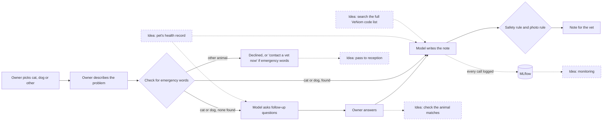

# Pet Triage Demo

A pet owner says what's wrong with their cat or dog. The app asks a few follow-up questions, then writes a short note for the vet: what the problem is, how urgent it is, and whether a photo would help. It's told not to diagnose or suggest treatment.

A small demo of **LangChain**, **MLflow** and a local model run with **Ollama**. **Prototype only:** the test cases are mostly made up and labelled by a non-vet.

## What it shows

- **A LangChain chain that asks questions.** Two main model calls: one asks the follow-up questions, one writes the vet's note. The model has to reply in a fixed format, so it can only pick complaint codes from our list.
- **MLflow tracking and comparison.** Every conversation is logged: settings, timings, the note, and a trace of each model call. I used it to compare four prompt versions against a rules-only baseline on the same test cases.
- **Judgement about where the model fits.** The model reads messy text and asks questions. Plain code makes the safety decisions: which animals are covered, the final urgency (code can raise the model's choice, never lower it), and when to ask for a photo. **The model suggests, code decides.**

## How it works



Dashed boxes are ideas, not built.

1. **Pick the animal.** Cat, dog or other. Other animals are politely declined without calling the model, unless the message mentions an emergency sign; then the owner is told to contact a vet now.
2. **Check for emergency words**, such as "nothing comes up" or "struggling to breathe". If one is found, the model assesses the case straight away, and a confirmed emergency skips the questions. Word matching can't see "*not* struggling to breathe", so the model is asked whether each sign is really there, quoting the owner.
3. **Ask questions.** The model asks a few follow-up questions (one or two in testing).
4. **Write the note.** The model picks a complaint code and an urgency: emergency, within 24 hours, or routine.
5. **Apply the rules.** If an emergency word was found, the case stays an emergency unless the model shows, in the owner's own words, that the sign isn't there, and gives the same answer 4 more times. This rule can raise urgency but never lower it. Code also decides the photo request: skin, wound and eye problems, never in an emergency.

| File | What it does |
|---|---|
| `triage/conversation.py` | The conversation. **Start here.** |
| `triage/safety_floor.py` | Emergency words and the safety rule |
| `triage/chains.py`, `prompts/` | The LangChain chains, and prompt versions v1–v4 |
| `triage/mlflow_tracking.py` | What gets logged to MLflow |
| `evaluate.py` | Runs the test cases and logs the results |
| `web_demo.py`, `terminal_chat.py` | Web and terminal front ends |

Other modules are listed in `triage/__init__.py`.

## Results

Run locally on `qwen2.5:7b` at temperature 0, with a median of about 1.5 s per conversation. 7 test cases (6 made up, 1 real), each worded two ways: 14 conversations, plus 8 edge cases (such as other animals, non-health questions and problems with no matching code). These are small numbers, so a difference of one or two is noise. In MLflow, filter by `tags.study = "readme-results"`.

| | Rules only | v1 | v2 | v3 | v4 (default) |
|---|---|---|---|---|---|
| Emergencies caught (of 4) | 3 | 3 | 3 | 3 | 3 |
| … by the model alone, before the safety rule | – | 1 | 2 | 3 | 2 |
| Rated less urgent than expected (of 14) | **7** | 1 | 1 | 1 | 1 |
| Rated more urgent than expected (of 14) | 1 | 1 | 1 | 2 | 1 |
| Right complaint code (of 14) | 9 | 12 | 12 | 13 | 12 |
| Right photo request (of 14) | 13 | 12 | 12 | 12 | 13 |
| Edge cases handled as expected (of 8) | 5 | 5 | 5 | 7 | 7 |
| Input tokens per conversation | – | 798 | 929 | 1,131 | 904 |

**What each version changed, and why:**
- **v2** added plain definitions of each urgency level, after v1 rated a spreading skin sore as routine on a larger model. It was written after seeing that failure, so its score is partly fitted to the test.
- **v3** let the model decide whether to help at all (cats and dogs, health problems only), after an early test coded a raccoon stealing food as a lump.
- **v4** lets the owner pick the animal and lets code decide the photo request, after v3 turned away a real problem in one run (a dog suddenly eating stones).

**What I learned:**
- **Rules and the model need each other.** Rules alone rated half the conversations less urgent than expected. The model alone missed emergencies that the word list caught (v1 caught just 1 of 4 by itself).
- **One emergency is missed by every version:** a blocked cat described as "only a few drops of wee come out". No emergency phrase matches it, and the model rates it "within 24 hours", even when its own reasoning calls it possibly life-threatening (v1).
- **v4 trades a little for safety.** No cat or dog is ever turned away, it no longer asks for photos during emergencies, and it uses about 20% fewer tokens. The cost: a dog-training question now reaches the vet instead of being declined.
- **The small model is unreliable at checking emergency signs.** It skipped the check in 12 of 19 cases, and when it did answer, 4 of 7 times it quoted our instructions instead of the owner. The safety rule treats both as "still an emergency", which is why "*not* struggling to breathe" is rated an emergency by every version.
- **Found in my own testing:** a cat called Lily was flagged as possible poisoning, because "lily" was on the emergency word list. It now needs context ("a lily", "lily pollen"), and a test checks it.
- **Still to watch:** about half the notes for the vet name a possible condition (by a keyword search), though none of the questions owners saw offered a diagnosis. And v4 asks fewer questions than v3, often just one.
- **One real case:** my cat had a painful lump after being neutered. I wrote the message down before running anything, and labelled it with what the vet nurse decided at the time (an appointment the next day). Every prompt version matched it.

## Run it

Needs Python 3.11+.

```bash
python -m venv .venv
source .venv/bin/activate          # Windows: .venv\Scripts\activate
pip install -r requirements.txt
ollama pull qwen2.5:7b             # skip if you use your own model or API key
streamlit run web_demo.py
```

| | |
|---|---|
| Terminal chat | `python terminal_chat.py` |
| Run the test cases, logged to MLflow | `python evaluate.py` (add `--prompt-version v3`, `--baseline lexical` or `--edge-cases`) |
| Open MLflow | `mlflow ui --backend-store-uri sqlite:///mlflow.db` |
| Unit tests (no model needed) | `pytest` |
| Compare local models | `python run_model_comparison.py --models qwen2.5:7b qwen3:8b` |

**Your own model or API key:** copy `.env.example` to `.env`. It covers Ollama, OpenAI, Anthropic and local OpenAI-compatible servers. Keys stay in `.env` and are never logged.

**Docker:** `docker compose up -d`, then `docker compose exec ollama ollama pull qwen2.5:7b`, and open http://localhost:8501.

GitHub Actions runs the linter, the tests and a Docker build on every push.

## Limits and next steps

- **Not clinically validated.** It needs cases labelled by vets, then a trial running quietly alongside vets, before anyone relies on it.
- **Placeholder codes.** Real VeNom codes (a standard UK list of veterinary terms) are licensed on request, so this uses made-up `DEMO-xxx` codes. Swapping them in is a data change.
- **Next:** the ideas in the diagram, and monitoring how often vets correct the notes and how many alarms are false, rerunning `evaluate.py` before every change.

## License

[MIT](LICENSE)
